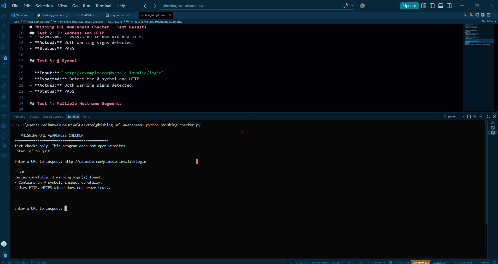
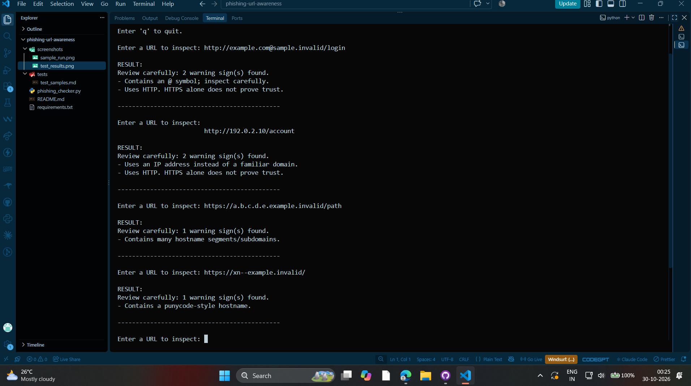

# Phishing URL Awareness Checker

An educational cybersecurity project that helps users identify common warning signs in potentially suspicious URLs. The project includes a Python command-line checker and a Flask-based web interface that displays detected warnings with explanations.

## Overview

Phishing attacks often use deceptive URLs to trick users into visiting malicious websites or sharing sensitive information. This project demonstrates how simple URL inspection techniques can help users recognize suspicious patterns.

The checker analyzes the text of a URL and identifies selected warning signs without visiting the website or making network requests.

**Important:** This is an educational awareness tool, not a definitive phishing detector. A URL with no warnings may still be dangerous.

## Features

- Detects URLs containing the `@` symbol.
- Flags URLs longer than 100 characters.
- Identifies IPv4-style hostnames.
- Flags hostnames containing five or more labels.
- Detects the `xn--` punycode marker.
- Identifies URLs using HTTP.
- Provides explanations for detected warning signs.
- Includes a command-line interface.
- Includes a browser-based Flask web interface.
- Handles malformed URL input without crashing.
- Does not visit URLs or make network requests.

## Technologies Used

- Python
- Flask
- HTML
- CSS
- Git and GitHub
- Gunicorn for production deployment

## Project Structure

```text
phishing-url-awareness/
│
├── app.py
├── phishing_checker.py
├── requirements.txt
├── README.md
│
├── screenshots/
│   ├── sample_run.png
│   └── test_results.png
│
└── tests/
    └── test_samples.md
```

## Requirements

- Python 3
- pip
- A web browser for the web interface
- Git (optional, for version control)

## Installation

Clone the repository:

```bash
git clone https://github.com/Shaibanya/phishing-url-awareness.git
```

Navigate into the project directory:

```bash
cd phishing-url-awareness
```

Install the required dependencies:

```bash
python -m pip install -r requirements.txt
```

## How to Run the Command-Line Checker

Run:

```bash
python phishing_checker.py
```

Follow the prompts to enter a URL and inspect the displayed warnings.

The command-line checker examines the URL text and reports any recognized patterns.

## How to Run the Web Application

The project also provides a browser-based interface built with Flask.

### 1. Install dependencies

```bash
python -m pip install -r requirements.txt
```

### 2. Start the application

```bash
python app.py
```

### 3. Open the website

Open the following address in your browser:

```text
http://127.0.0.1:5000/
```

### 4. Check a URL

Enter a URL in the input field and click **Check URL**.

The application displays detected warning signs and explanations to help users understand why those patterns may deserve attention.

## Example

Input:

```text
http://192.0.2.10/account
```

Expected warning signs include:

- **Uses an IP address instead of a familiar domain.**
- **Uses HTTP. HTTPS alone does not prove trust.**

The application explains why each warning matters.

The example IP address belongs to a documentation range and is used here for demonstration.

## Testing

The checker was tested with representative URL patterns, including:

| Test case | Expected result |
|---|---|
| Ordinary HTTPS URL | No listed warning signs for the example |
| URL containing an IPv4 address | IP-address warning |
| URL containing `@` | At-sign warning |
| URL with a long hostname | Hostname-label warning when the threshold is met |
| URL containing `xn--` | Punycode warning |
| Malformed URL such as `http://[bad` | Error message instead of a crash |

Detailed test cases and results are documented in `tests/test_samples.md`.

**Note:** These tests verify the selected warning rules. They do not establish whether a URL is genuinely safe or malicious.

## Screenshots

### Command-Line Sample Run



### Test Results



## Web Application

The Flask web interface allows users to enter a URL through a browser and review the warning signs detected by the checker.

The interface displays explanations alongside the results and includes a notice explaining the limitations of URL-based inspection.

### Live Demo

**Live demo:** To be added after successful deployment.

## Possible Improvements

Future improvements could include:

1. Adding more URL inspection rules and improving hostname parsing.
2. Developing automated unit tests for individual detection rules.
3. Improving accessibility and the web interface.
4. Adding a clearer separation between malformed input and valid URLs with warning signs.
5. Expanding educational guidance about phishing prevention.

## Limitations

- The checker uses a limited set of heuristic rules.
- It does not visit websites or inspect their content.
- It does not verify domain ownership, certificates, reputation, or website behavior.
- Legitimate URLs may trigger warnings.
- Malicious URLs may not trigger any warnings.
- HTTPS does not guarantee that a website is trustworthy.
- A URL with no detected warning signs should not be considered safe solely because of this tool.

## Ethical Use

This project is intended for cybersecurity awareness, educational demonstrations, and learning about suspicious URL patterns.

Do not enter confidential information into untrusted websites. Always verify website addresses independently before sharing passwords, payment information, or other sensitive data.

## Author

**Shaibanya Dey**

GitHub: [Shaibanya](https://github.com/Shaibanya)

## Disclaimer

## Disclaimer

This project is an educational tool provided for cybersecurity awareness
and learning purposes only. It does not guarantee the detection of
phishing attacks and should not replace professional security tools
or careful verification of website addresses.